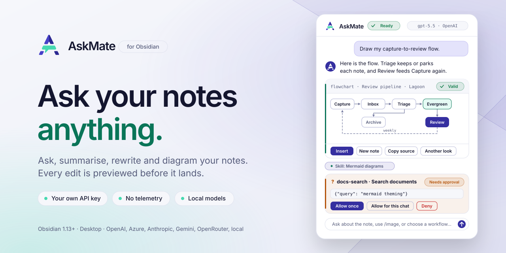

<p align="center">
  <picture>
    <source media="(prefers-color-scheme: dark)" srcset="assets/hero-dark.svg">
    
  </picture>
</p>

<h1 align="center">AskMate</h1>

<p align="center"><strong>Ask your notes. Draw them. Apply changes safely.</strong></p>

AskMate is an AI sidebar for Obsidian. It answers questions about the note you are reading, draws it as a Mermaid diagram that actually renders, calls your MCP tools only after you approve (call by call, unless you relax it), and writes to a note only when you choose Apply, New note or Insert.

<p align="center">
  <a href="https://obsidian.md/plugins?id=askmate"><strong>Install from Community plugins</strong></a> ·
  <a href="#manual-install">Manual install</a> ·
  <a href="docs/README.md">Docs</a> ·
  <a href="CHANGELOG.md">Changelog</a>
</p>

<p align="center">No telemetry · No AskMate server · Keys stay in Obsidian SecretStorage · Nothing in your notes changes until you approve · MIT licence · Desktop, Obsidian 1.13.0 or newer</p>

## What you get

| Feature | What you get |
| --- | --- |
| **Mermaid Diagram Studio** | Ask for a diagram in plain words. AskMate picks the type, gives it one of eight looks, checks it against Obsidian's own Mermaid, repairs it once if needed, and never shows a broken one as finished. |
| **MCP tools** | Connect MCP servers over HTTP, or run one locally on desktop. Off by default, trusted per device, and by default every call asks first with the full arguments on screen. |
| **Safe Apply** | Replace a selection, append, or replace a section. By default you see a diff first, a replacement is refused if the note changed during the preview, and AskMate never writes tool output to your vault. |
| **Skills** | Reusable `SKILL.md` instructions. One ships built in, your own start inert until you review them. |
| **Ask about the note** | Selection or whole note as context, `@links`, `@backlinks`, `@tag:` and `@recent` mentions, streaming replies, saved conversations. |
| **Workflows** | Eighteen built-in prompts and your own: summaries, action plans, flashcards, translation and more, from the sidebar, palette or editor menu. |
| **Your provider** | OpenAI, Azure OpenAI, Azure AI Foundry, OpenRouter, Anthropic Claude, Google Gemini, or a local OpenAI-compatible server. |
| **Images** | `/image` creates pictures with OpenAI `gpt-image-2`. |

## Quick start

1. **Install.** In Obsidian open Settings, Community plugins, Browse, search for AskMate, then Install and Enable. A notice offers a Set up button.
2. **Connect.** In the AskMate sidebar choose OpenAI, Anthropic, Gemini or Local, paste your API key and press Connect. The key goes into Obsidian SecretStorage, a test runs, and a failure is explained in plain words.
3. **Ask.** Open a note and press a starter chip: Summarise this note, Make a diagram or Find gaps.

AskMate is free. You pay your provider directly under its own pricing, or run a local model at no charge. Image generation needs a paid OpenAI API account. Your provider's billing page is the authority on what you are charged.

Try these in the composer:

```text
Summarise this note into action items.
Draw this as a diagram.
@backlinks What do these notes agree on?
/polish keep it short
```

Slash commands and `@` mentions work in every sidebar layout (Compact, Expanded and Console). Type `/help` to list them.

## Mermaid Diagram Studio

Say `Draw this as a diagram`, type `/diagram`, or press Make a diagram. AskMate chooses a type that fits your note, from flowcharts and sequences to Gantt, timelines, mind maps, architecture and more, and uses only what is in the note. Eight looks (Blueprint, Sketchbook, Editorial Ink, Sunrise, Lagoon, Grape Soda, Slate and Terminal) use colours checked for contrast, and Another look draws it again in the next one.

Every diagram is parsed and rendered with the Mermaid that ships in Obsidian before you see it. If it fails, AskMate repairs it once, and if it still fails it shows the source and disables Insert and New note for that reply. If the model answers in words and draws nothing, that reply is ordinary text and nothing is blocked. Diagram requests never go to paid image generation. See [diagrams](docs/diagrams.md).

## Apply changes safely

Nothing reaches a note unless you choose Apply, New note or Insert.

- **Diff first.** By default you see what will change before every write. Replacing a whole note always asks.
- **Right note, right text.** Apply targets the note captured when you asked, and matches selected text exactly.
- **No surprises.** If the note changed during the preview, or the reply was cut short, AskMate refuses to replace text.
- **Safe text.** Replies are sanitised before they render or write: remote images, scripts, plugin code blocks and risky links are neutralised.

See [apply](docs/apply.md).

## Connect tools with MCP

The Model Context Protocol lets AskMate use tools outside Obsidian. On the `Skills and tools` settings page, add a remote Streamable HTTP server or, on desktop, a local program. You can also paste the `mcpServers` JSON from Claude Desktop, Cursor or VS Code to import.

- Off until you turn on `Allow tools`. Nothing starts at load.
- You review the exact command or address and trust it on each device. Any change needs trust again.
- Each call shows the server, the tool and the full arguments. `Ask before every call` (the default) offers Allow once or Deny and remembers nothing. `Ask once for each tool in a chat` also offers Allow for this chat, and that tool then runs without asking again in that conversation. Tools are used for questions in the sidebar's Chat mode, and a reply that uses them arrives in one piece.
- `Tool rounds per answer` (5 by default, up to 12) gives the model that many turns of tool calls plus one last turn without tools to write the answer, and an answer makes at most 12 calls. `Longest tool result` (20,000 characters by default) cuts each result at exactly that length. AskMate applies both as set.
- A tool that changes its description after you approved it is flagged and asks again.
- Tool descriptions and results are untrusted text. They are cleaned, capped and kept out of the instructions.

A local server is a child process with your user's permissions, so add only commands you would run yourself. See [MCP tools](docs/mcp.md) and [skills](docs/skills.md).

## What AskMate touches

| Area | Behaviour |
| --- | --- |
| Network | Your AI provider, MCP servers you add, and nothing else. No analytics. Requests go out only when you send a question, test a connection, refresh models or test an MCP server. A trusted MCP server is contacted when a question could use its tools. |
| Notes it reads | The selection or the open note. Other notes only through `@` mentions or context sources you turn on. `/context` shows what the next request holds. Skill files in your skills folder (`AskMate/Skills` by default) are read on your device, and a skill's text is sent to the model only when that skill is used. |
| Notes it writes | Only through Apply, New note or Insert, after the checks and the diff. With no selection, Apply appends generated output to the captured note instead of overwriting it. The Apply approval mode is the `Ask before changing my notes` setting: `Every time` (the default), `When replacing a whole note or a section`, or `Yes or no, only when replacing the whole note`. The first always shows a diff, the second shows one for a whole note or a section, and the last asks only yes or no before a whole note is replaced and writes smaller edits without asking. Replacing the whole note always asks. |
| Clipboard | Write only, when you press Copy. |
| Secrets | API keys and MCP tokens in Obsidian SecretStorage. Settings keep only names. |
| Local data | `data.json` in the plugin folder: settings, approved skill hashes, MCP definitions, saved conversations (up to 50 threads of 200 messages, 2 MiB in all with the oldest first, and a saved reply cut at 50,000 characters; when a load has to cut anything, AskMate shows a notice and keeps a `data.json.before-trim-` copy), note history (12 turns per note, 200 turns across all notes), the review queue and token counts. It syncs if you sync your configuration folder, and then you repeat a deletion on each device. |
| Cost | Billed by your provider. Usage budgets can warn or block large requests, and AskMate always asks before sending one estimated at 150,000 input tokens or more. |
| MCP and child processes | Local servers run as a child process on desktop only, after you trust them, with your account's permissions: they can read and write any file you can, including your vault. Remote servers see the arguments of calls you approve. |

Details, the plain-http allowlist and rendering safety are in [privacy](docs/privacy.md) and [apply](docs/apply.md).

## Is AskMate right for you?

**A good fit** if you want an assistant that works on the note in front of you, you are happy to bring your own API key or run a local model, you want diagrams and tool calls you can inspect, and you want to approve every edit.

**Look elsewhere** if you want an agent that roams the whole vault and edits files on its own, a hosted plan with no key to manage, or mobile support. AskMate is desktop only.

## Manual install

Download `main.js`, `manifest.json` and `styles.css` from the [latest release](https://github.com/CodeWithBehnam/askmate/releases/latest), put them in `<YourVault>/.obsidian/plugins/askmate/` (your vault's configuration folder), reload Obsidian and enable AskMate. Obsidian 1.11.4 to 1.12.x is offered AskMate 1.8.2, the last release for those versions.

## Documentation

[Commands](docs/commands.md) · [Workflows](docs/workflows.md) · [Providers](docs/providers.md) · [Apply and output](docs/apply.md) · [Privacy and data](docs/privacy.md) · [Troubleshooting](docs/troubleshooting.md)

## FAQ

<details>
<summary>Does AskMate send my whole vault?</summary>

No. A request holds your prompt and the context you chose: by default the selection or the open note. Other notes are added only by an `@` mention or a context source you enabled. `/context` lists exactly what would go, and turning off `Send the current note with each question` on the `Privacy and memory` page keeps the note's text, path and title out of requests.

</details>

<details>
<summary>Can I use a local model or Azure?</summary>

Yes. Choose Local or self-hosted and set an OpenAI-compatible address such as `http://localhost:11434/v1`. Azure OpenAI and Azure AI Foundry are supported with your own endpoint and deployment name. See [providers](docs/providers.md).

</details>

<details>
<summary>Does image generation need OpenAI?</summary>

Yes. Images always use OpenAI `gpt-image-2`, whichever chat provider you choose, and need an OpenAI API key with access to that model. When another provider answers chat, add the key under `OpenAI image API key` on the `Connection` page.

</details>

<details>
<summary>My note shows Mermaid code, not a picture.</summary>

Newer versions of Obsidian can ask once per vault whether to trust Mermaid diagrams. Choose Trust when asked. AskMate never changes that choice.

</details>

<details>
<summary>Can an MCP server read my files?</summary>

A local server runs as a child process with your account's permissions, so it can. That is why it needs your trust per device and, by default, your approval per call, and why you should only add commands you trust. A remote server sees only the arguments you approve.

</details>

<details>
<summary>Does it work on mobile?</summary>

Not yet. AskMate is marked desktop only because it was designed and tested for desktop Obsidian.

</details>

<details>
<summary>How do I report a bug or a security problem?</summary>

Use the [issue templates](https://github.com/CodeWithBehnam/askmate/issues/new/choose) for bugs and ideas. Report security problems privately, as described in [SECURITY.md](SECURITY.md).

</details>

## Contributing

Read [CONTRIBUTING.md](CONTRIBUTING.md). Changes are checked with `bun run lint`, `bun run typecheck:tests`, `bun run test` and `bun run build`.

## Licence

MIT. See [LICENSE](LICENSE).
